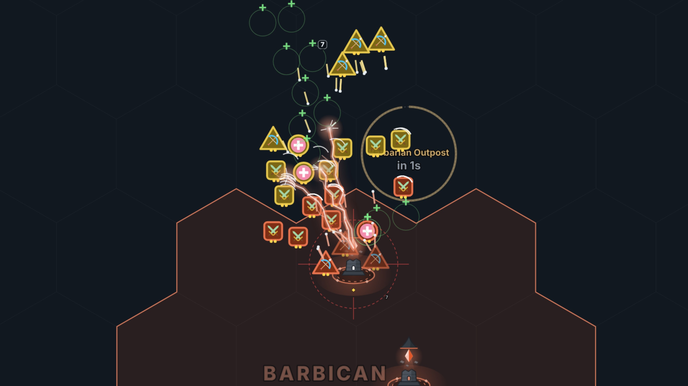
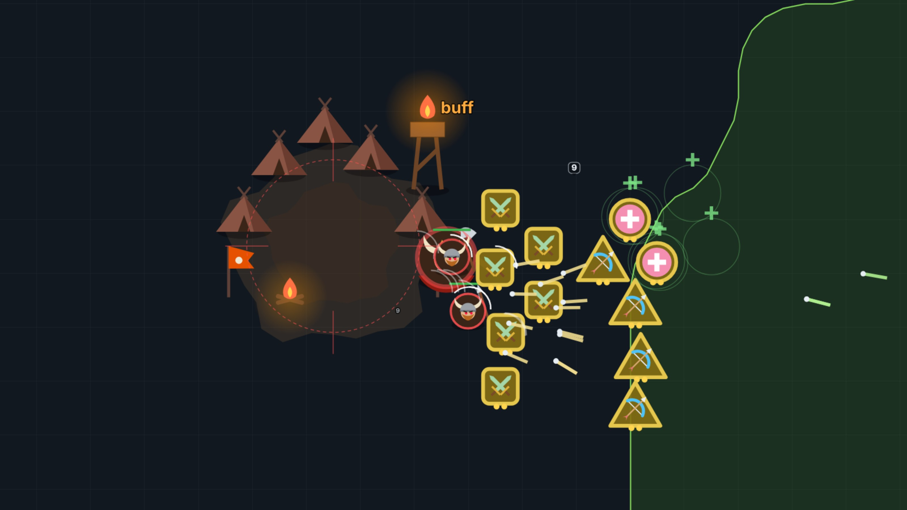
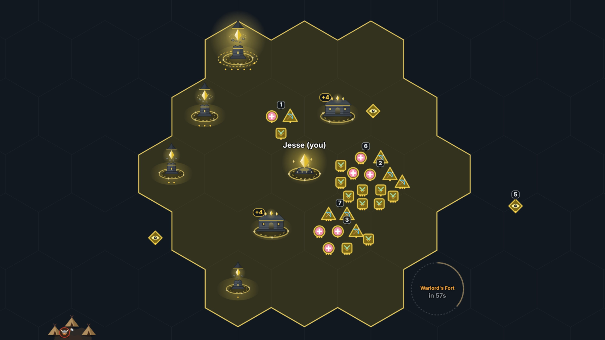
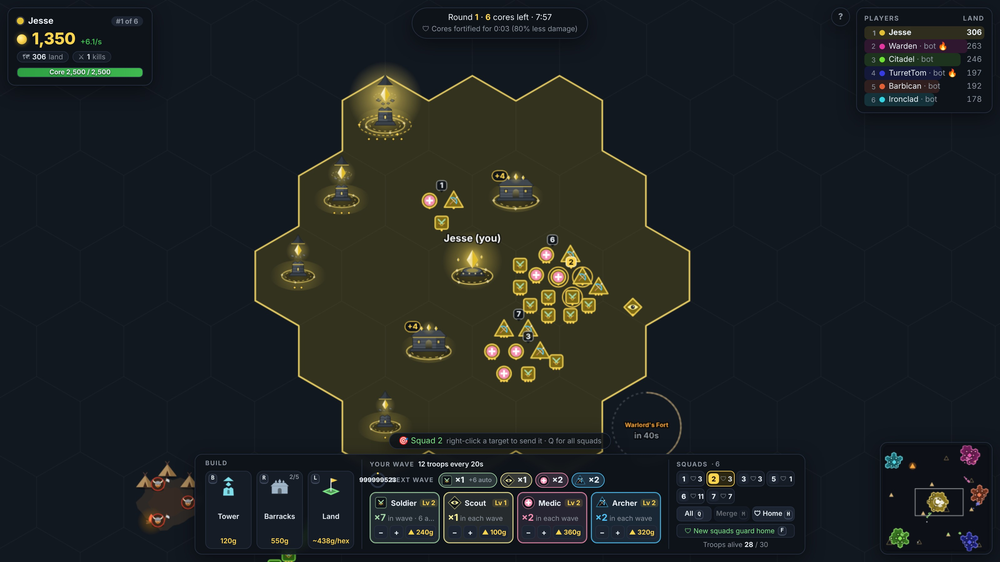
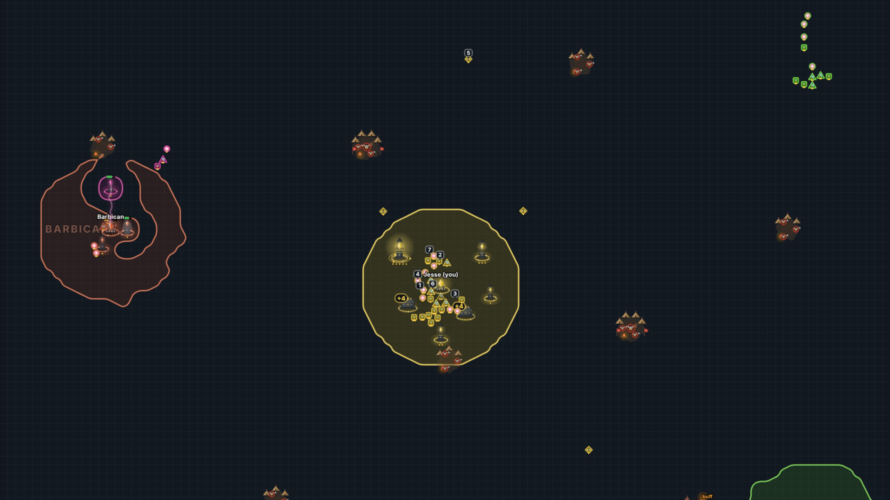

# Territory Siege

A multiplayer **.io strategy game with a League-of-Legends feel**. Every player has a core on one shared map
that sends out **waves of troops** every 20 seconds. Point your waves at a rival's towers to push, or pull
them home to defend. **Buy land** with gold along your border; more land means more gold and a bigger army. Towers defend it.



| | |
|---|---|
|  |  |
|  |  |


## Run it

```bash
npm install
npm start          # http://localhost:3000  (set PORT to change)
npm test
```

Open the URL in a few browser tabs (or share it on your LAN) to play against each other.
To put it online for friends, follow **[HOSTING.md](HOSTING.md)** (free, about 10 minutes, on Render).
AI bots fill the server up to 6 players, so it's playable alone too.


### Updating automatically (Windows)

Download the game once with **Git** instead of a ZIP; after that, every start fetches the latest version.

1. Install Git once: `winget install --id Git.Git` (then open a new Command Prompt).
2. Download the game once (it goes into a folder called `territory-siege`):
   ```
   git clone -b claude/determined-johnson-hion2w https://github.com/jesahowl/test.git territory-siege
   ```
3. From then on, just double-click a file in that folder:
   - **`play.bat`**: updates, installs and starts the game, and opens http://localhost:3000.
   - **`play-online.bat`**: the same, plus a Cloudflare link (`https://....trycloudflare.com`) friends can join from.
     Needs `winget install --id Cloudflare.cloudflared` once.

Each start shows which version you had and which you have now ("Was" / "Now"), and stops a game
server still running from last time so the new version loads. Then press **F5** in the browser
(friends too). To update without starting the game, double-click **`update.bat`**.

If an update is ever blocked (it says files in the folder were changed), run this in the folder to
throw those changes away and get the latest version:
```
git fetch origin claude/determined-johnson-hion2w
git reset --hard origin/claude/determined-johnson-hion2w
```

## Private rooms

On the menu, **Create private room** gives you a 5-letter room code and an invite link
(`…/?room=K7QXM`). Friends join by typing the code or opening the link. In the lobby the host
(👑) chooses how many bots to add (0–10) and presses **Start round**; anyone who arrives mid-round
watches and joins the next one. After each round's scoreboard everyone returns to the lobby. A round
also ends early if no humans are left. If the host leaves, someone else becomes host; an empty room
closes after a minute. **Play** still drops you into the always-running public game.

## How to play

| | |
|---|---|
| **Waves** | Every 20s your core sends out a free wave of **4 troops**: to start with, one of each type (soldier, scout, medic, archer). |
| **Barracks** | Build **barracks** (`R`, on your own land) for **+4 troops in every wave**. Each barracks' 4 march out from the barracks itself and join that wave's squad. Up to 5 barracks (24 troops per wave). They cost 250g, then 150g more for each one you own. They don't shoot or level up, and like towers they can be destroyed: whoever destroys one takes it over, with its +4. |
| **Alliances** | Offer an alliance with the **+🤝** button in the player list; the other player accepts (bots weigh it up). Allies don't fight each other and can see each other's bases. Attacking an ally asks first and breaks the alliance. At most 2 allies; every alliance ends when sudden death starts. |
| **Trade** | Build a **Trade Post** (`T`, 220g, up to 2) and, with an ally who has one too, a **caravan** sets off for their post every 30s along a road that steers round hostile towers. When it arrives you **both** get its cargo (more for longer routes and higher post levels). Two guards ride with it and fight back; enemies who destroy it take half the cargo. Click a trade post or caravan to see its road; right-click your caravan to send a squad as **escort**. If the alliance ends, caravans on the road vanish. |
| **Walls** | Press `V` and **drag along your border** to wall it (15g a segment, on the edges between your hexes and land that isn't yours). Walls block **every** troop and caravan, yours too: click one and make it a **gate** (40g) to let your troops, caravans and allies through. Walls are your border lifted up into a see-through band of light in your colour, 600 HP each (no upgrades). Gates are the same band opened into a doorway. Attackers path round walls when they can and otherwise hack through the weakest point; soldiers hit walls twice as hard. A broken wall can't be rebuilt for 45s, and you can't build with enemies right at it. Buying the hex beyond a wall refunds it; losing the hex behind it makes it crumble. Bots wall the side facing their nearest enemy, with two gates. |
| **Army mix** | The army panel decides **which troops fill your wave slots**, for free (`1`–`4` / `+`). Unassigned slots are filled with soldiers. Gold goes into **levelling troop types** (`Shift`+number), barracks and towers. |
| **Squads** | **Every wave marches out as a squad of its own**, numbered 1, 2, 3… (the lowest free number; a wiped-out squad's number is reused). A squad **sticks together**: on the march it moves at its slowest troop's pace and troops that run ahead wait for it, and **standing troops form up inside a hex**: evenly spaced, one in the middle, a ring of 6 round it and an outer ring of 12 (a bigger squad spills into the next hex). At home each squad takes its own hex next to the core, guards of a tower form up round it in its hex, and a squad holding a spot fills the hex you clicked. **Troops at home defend automatically**: any enemy troop (or angry barbarian) that comes onto your land or into a hex next to it, within 8 tiles of them, gets attacked, and they fight from their own side of the border, never chasing it off your land. Its number floats above it on the map, nudged to a free spot so it never covers another squad's number, an enemy or a building. Troops also keep a little **personal space** from their own side and never stand inside buildings. In a fight, **melee troops close right in** on their enemy (front lines meet and interlock), and **every sword swing is a quick lunge** at the target that springs back. **Click any of its troops** (or its chip in the Squads panel, or press its number `1`–`9`) to pick it, `Shift` to pick more, `Q` for all squads, then **right-click** a target. `M` merges the picked squads. New squads **guard home**, or with **F** they **follow your last order**. `H` sends every squad home. |
| **Fog of war** | The map starts dark except your own land and what your core (9 tiles), towers (range + 2), barracks and troops can see; scouts see furthest. **Once an area has been explored, the fog there is cleared for good**: you keep seeing everything that happens there (troops, fights, buildings, camps), even after your troops leave. Enemy troops in unexplored fog aren't even sent to your browser. Spectators see everything. |
| **Regrouping** | **Ctrl-click** single troops to pick them, then press a squad's number (or click its chip) to move them into it, or `N` to make them a new squad. Right-clicking with troops picked sends them off as a new squad. |
| **Moving** | **Right-click empty ground** to send the picked squads there. They hold the spot, fight enemies that come within 6 tiles of it, and come back to it afterwards. |
| **Hunting** | **Right-click an enemy troop** to send your troops after it. They chase it down and focus it, ignoring other enemies on the way. When it dies they go after its squadmates within 6 tiles, then head home once the squad is gone. A red crosshair marks troops you're hunting. Hunts use the picked squads (or picked troops) like other orders, but are a one-off: the squads keep their standing orders. |
| **The push** | Troops march across the map (pathfinding around structures), fight whatever they meet, then hit the target. When a tower falls, the push rolls on to that player's next tower, then their core. |
| **Land** | The map is a grid of **hexagons**, and land is owned hex by hex. You start with your core's hex and the six around it. **Claim more with gold**: press `L` (or the **Land** button), then click an empty hex touching your border, or **drag along it** to claim a strip. **Double-click anywhere outside your land** to grow it one hex outward all round (if your gold doesn't cover the whole ring, the hexes nearest where you clicked come first). A hex costs more the more land you own (about 140g each at the start). **Enemy land can't be claimed**: take one of their towers and their hexes next to it open up (you get the tower's hex), and **destroying a core wins you all of that player's land** (a player who leaves is replaced by a bot, who keeps it). Open hexes can be claimed by anyone whose land touches them. A hex with a building in it always stays its owner's. |
| **Towers** | Zap enemy troops with **chain lightning** (58 damage; each bolt jumps on to up to 2 more enemies nearby, at 75% of the previous hit, so crowds suffer most). Cores zap the same way. A level 1 tower holds off one wave, two waves take it with heavy losses, and a level 3 tower needs a real army and **hold your land** (they claim none themselves). Each is a wizard tower whose top floats in pieces above its broken stump, held up by magic around a crystal. Your core (a great crystal over a rune circle) zaps too. Barracks are crystal halls: stone halls with crystals on the roof ridge and a doorway that flares as each wave marches out. Higher levels: a taller stump with a band, a spinning rune ring, gold runes and a glowing aura. Towers and barracks stand at the centre of one of your own hexes, one building per hex, and not in a hex next to an enemy building or core. |
| **Taking towers** | **Destroy** one and it becomes yours (+150g): it keeps its level, comes back at 70% health, and the enemy's hexes next to it open up (you get the tower's own hex). The attackers stay on as its garrison and your waves push on to that player's next tower. Towers only become ruins when their owner's core falls with nobody to take them. |
| **Gold** | Land pays a steady income (1.5g/s + 0.015g/s per tile; tiles beyond 400 pay 40% of that, so a huge empire doesn't run away with the game). The rest comes from fighting: 14g per enemy troop killed (+6 per troop level), 40–250g per barbarian (a whole camp pays 120–370g), 150g for a tower, and 250g plus all of their gold for a core. Each bounty pops up where you earned it, and the death screen breaks down where your gold came from. |
| **Barbarian camps** | 12 neutral barbarian camps, spread out (each is placed as far as possible from the others, at least 18 tiles apart), in three sizes: **Raider Camp** (3 axe raiders, 120g), **Barbarian Outpost** (a club-wielding brute + 2 raiders, 190g) and **Warlord's Fort** (a crowned warlord + 2 spearmen, 370g + buff). Each camp is a **tent village** on trampled earth: 3 tents for a Raider Camp, 4 plus war banners for an Outpost, and 5 with a watchtower for the Warlord's Fort (its beacon fire marks the buff). Barbarians are red-rimmed tokens with horned helmets; the weapon tells you the type. They're passive until attacked, then the whole camp fights back. Hover a camp to see what it pays; right-click it to send troops. They come back after 45s (the Warlord's Fort after 90s) **in a new random spot**, shown on the map and minimap with a countdown ring. |
| **Jungle buff** | Defeating a **Warlord's Fort** (marked 🔥 buff) empowers all your troops for 60s: **+30% damage and 25% less damage taken**. Buffed troops glow orange and a 🔥 shows next to your name. |
| **Rounds** | **Last core standing wins.** Joining is open for the first 60s of a round (bots fill in during that time too). After that, newcomers watch and join the next round automatically. Cores are **fortified for the first 8 minutes** (they take 80% less damage), and from minute 8 troops hit buildings **10% harder every minute**, so early rushes can't knock anyone out but pushes keep getting stronger. After **19 minutes, sudden death** starts: no home-turf bonus, troops deal double damage to towers and cores, and cores slowly crumble, so every round ends. Then a scoreboard shows everyone's placing and a new round starts on a fresh map 15s later. If only bots are left, pressing *New round* starts one straight away. |
| **Home turf** | Troops on their own land heal 2% HP/s and deal +30% damage, so defending is cheaper than attacking. |
| **Army size** | You can have 1 troop alive per 10 tiles of land (min 10, max 45), and always at least one full wave. Waves stop spawning at the cap. |
| **Spawning** | Each base spawns at a random spot, as far as possible from everyone already playing (and their buildings), so bases spread evenly over the map with a different layout every game. |
| **Spawn protection** | For 2 minutes after spawning your core and towers can't be damaged. |
| **Losing** | If your core falls you're **out of the round**. Whoever destroyed it takes the spoils: **all your gold** (plus a 250g bounty), **all your land**, **all your towers and barracks**, **every troop you still had standing**, and your core site, which becomes **one of their towers** garrisoned by your former troops. You can then **spectate** (follow any player with Tab, free camera with WASD, Space to follow again) and you join the next round automatically. If you leave mid-round, **a bot takes over your base** under your name (core, land, gold, buildings and troops) and plays on. |

### Troops

Each type has its own token shape, so you can tell them apart at a glance: soldiers are **rounded squares**, scouts **diamonds**, medics **circles** and archers **triangles**.

| Troop | Wave slots | Level 2 | HP | Role |
|---|---|---|---|---|
| Soldier | 1 | 120g | 340 | Sword and shield: the backbone of every wave. Unassigned slots are filled with soldiers. Your first wave has one of each type |
| Scout | 1 | 100g | 110 | Very fast, sees 11 tiles, **never fights**. While your troops defend, scouts **explore on their own**, heading for ground you haven't seen and staying clear of enemy guns |
| Medic | 1 | 180g | 200 | Heals the **two most wounded** troops near it (15 HP/s each), never attacks |
| Archer | 1 | 160g | 170 | **Shoots arrows from range** (5 tiles). Fragile: keep soldiers in front of them |

The **Lv** button on each troop card levels that type up
(+50% HP, +60% damage, +0.5 range per level, **max 5**); levels apply to troops spawned after.
Levels 4 and 5 (for troops and towers) cost a lot more: a late-game place to spend gold. Towers stop gaining land after level 3,
and get a turning gold rune ring at level 4 and a radiant aura at level 5.

### Controls

| Key | Action |
|---|---|
| Right-click target | Order troops: attack an enemy tower/core/camp, hunt an enemy troop, or defend your own tower/core |
| Left-click a troop | Pick its squad (`Shift` adds another squad) |
| `1`–`9` | Pick that squad (press twice to find it). With troops picked: move them into it |
| `Q` | Orders go to all squads |
| `M` | Merge the picked squads |
| `Ctrl`+click troops | Pick single troops (`N`: make them a new squad) |
| `F` | New squads: guard home / follow your last order |
| Left-click a tower | Select it |
| `Esc` | Clear picked troops / selected building |
| `H` | Every squad defends your core |
| `R` | Place a barracks (your own land only): +4 troops per wave |
| `T` | Place a trade post (your own land only): sends caravans to an ally's trade post |
| `V` | Build walls: drag along your border. Click a wall to make it a gate, or knock it down (`Del`) |
| `L` | Claim land: click empty hexes at your border, or drag along it (shows the price) |
| Double-click outside your land | Grow your land one hex outward all round |
| `B` | Place a tower in one of your hexes (it stands at the hex's centre) |
| `U` / `Del` | Upgrade / sell the selected tower (no selling for 5s after it's hit) |
| `WASD` / arrows / right-drag | Pan. Wheel zooms. `Space` jumps home. Click the minimap to jump. `?` opens the controls & how-to-play window. |

### Interface

- **Player card** (top left): gold and income, land, kills, spawn protection / jungle buff, and your core's health.
- **Command bar** (bottom): *Build* (tower, barracks), *Your wave* (countdown ring, a **Next wave** lineup with a chip per troop type showing how many are coming, auto-filled soldiers marked *auto*, and one card per troop type with +/− and level-up; types in the wave get a coloured border), and *Squads* (a chip per squad with its number, order and size; All, Merge, Home, the new-squads setting, troops alive).
- **Hover anything** for a tooltip explaining it, with costs and what an upgrade would change.
- **First-game tips** walk you through attacking, towers, barracks, the wave mix, squads and the jungle; each ticks off when you do it. `?` shows the controls and can bring the tips back.

All numbers live in [`shared/config.js`](shared/config.js), shared by server and client, so tuning happens in one place.
The most useful knobs: economy (`BASE_INCOME`, `INCOME_PER_TILE`, `TROOP_BOUNTY`, `TOWER_BOUNTY`, `CORE_KILL_BOUNTY`,
monster `bounty`, `CAMP_RESPAWN`, `CAMP_RELOCATE`), `WAVE_INTERVAL`, `BASE_WAVE`, `BARRACKS_TROOPS`, `MAX_BARRACKS`, `BARRACKS_COST_STEP`, `LAND_PER_UNIT`, troop and tower stats,
`CORE_DAMAGE`, `HOME_DAMAGE_BONUS`, `SPAWN_SHIELD`, `CAPTURE_TIME`, `TOWER_CLAIM_HP`, `CAMP_*`, jungle buff (`BUFF_CAMPS`, `JUNGLE_BUFF_*`),
rounds (`ROUND_JOIN_WINDOW`, `ROUND_SUDDEN_DEATH`, `SUDDEN_DEATH_*`, `CORE_FORTIFY*`, `SIEGE_RAMP_*`, `ROUND_RESET_DELAY`).

## Architecture

```
shared/config.js        game constants + stat/cost helpers (used by Node and the browser)
shared/pathfinding.js   flow-field Dijkstra used by marching troops
shared/vision.js        fog of war: who can see which tiles (server filtering + client drawing)
shared/hex.js           the hex grid: which hex each tile is in, neighbours, corners (land, buildings, borders)
server/index.js         HTTP static server + WebSocket, routes players to rooms, 20 Hz tick
server/room.js          a room: its game, rounds/lobby, and the 10 Hz per-player state broadcast
server/game.js          the Game class core: state, spatial grid, tick, snapshots
server/game/*.js        Game methods by topic, mixed into Game.prototype:
                          players (joining, rounds, pacing, gold) · territory · structures (build,
                          upgrade, sell) · army (wave mix, orders, waves) · jungle · combat (damage,
                          towers/cores shooting) · troops (movement, targeting, pathfinding) · fog · bots
                          common.js holds the shared constants and helpers
public/index.html, style.css
public/js/*.js          the browser client as ES modules (entry: main.js):
                          state (shared data; values several modules reassign live on S) · net
                          (WebSocket, interpolation) · fog · targets · territory · render · structures ·
                          troops · camps · cores · effects · overlay (build preview, markers, minimap) ·
                          ui (icons, tooltips) · bar (command bar) · hud · tips · screens · input · main
test/                   node:test suite (game rules, waves & orders, jungle, rounds, pathfinding, server)
```

- **Authoritative server.** Clients only send intents (`build`, `upgrade`, `sell`, `capture`, `army`, `order` with optional `ids` or `squads`, `squad` to move troops, merge squads or set what new squads do). The server validates everything.
- **State sync.** The game simulates 20 times a second and sends state 10 times a second. Entity lists (players, towers, troops,
  monsters, camps) go out as compact arrays containing only the rows that changed since the last update, plus removed ids; a
  client that just joined gets everything once. Positions are sent in tenths of a tile, and WebSocket compression
  (permessage-deflate) shrinks the rest about 7x: roughly 7 KB/s per player with 12 players. Each player also gets their own
  gold, army plan, standing order and wave timer. Territory is sent run-length encoded, only when it changes.
- **Spatial grid.** Troops are bucketed into 4x4-tile cells each tick, so targeting, tower fire, splash, healing and
  healing only look at nearby troops (24 players: about 4 ms per tick).
- **Territory.** The map is a hex grid (`shared/hex.js`, shared by server and browser) laid over the fine
  tile grid that troop movement, pathfinding and fog use: every tile belongs to the hex its centre falls in.
  Land is owned per hex: a core starts with its hex and the six around it, players claim empty hexes touching
  their land, a taken tower opens up its old owner's hexes next to it, and a destroyed core's land all goes to the
  player who destroyed it. Each player's land is outlined along the hex edges where it meets other land (chained
  into closed loops and drawn as vector paths), with a see-through fill in their colour, a solid border just inside
  its own edge, and the owner's name written across it.
- **Troop movement.** Attacking troops follow a flow field toward their target (Dijkstra from the goal tile, one per
  active goal, rebuilt lazily when structures change). Defending troops plan short BFS paths within their own land and
  patrol around the structure they guard.
- **Smooth movement.** Each snapshot carries the server tick number; the client draws troops and monsters 100 ms in the
  past, interpolating between snapshots on that steady clock, so movement stays smooth despite network jitter.
- **Bots** buy land at their border (growing round their core), build towers inside it, grow and level their army plan, defend when invaded, keep a squad farming jungle camps, and launch
  strike forces (60% of their home troops) at the nearest rival's towers while new waves stay home.

## Ideas for next steps

- Champions: one hero unit per player with abilities, leveling from kills
- Lanes or rally points, and attack-move orders
- Team mode (2v2 / 3v3)
- Mobile touch controls
